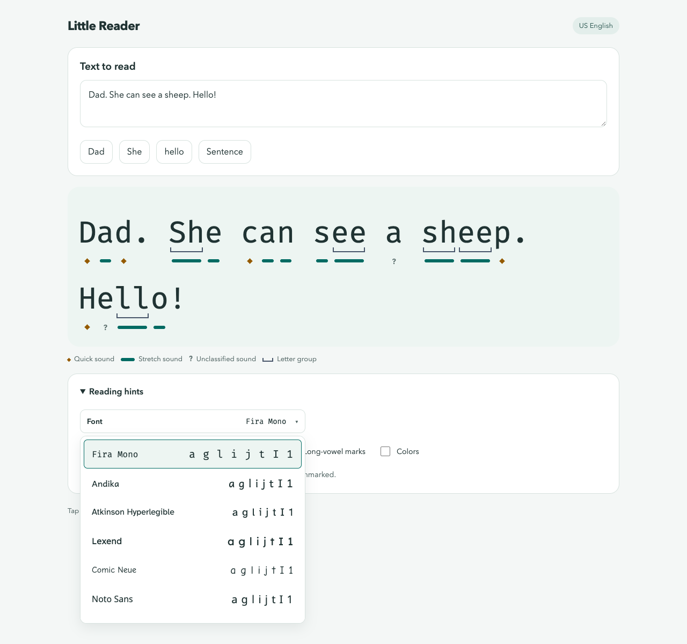

# Little Reader

Read together, with a little help from sound and letter hints.

**[Open Little Reader →](https://charlesbmi.github.io/phonics/)**

Type a sentence, then tap a word to hear it or adjust its hints. Tap again to close. **Reading hints** controls hints across the text and offers eight fonts with different letter shapes.

Quick sounds use filled diamonds; stretch sounds use rounded bars. Brackets connect letters that make one sound. A ? marks a sound without a quick/stretch classification. Optional vowel marks and colors add help when needed.

Dictionary lookups load as you type. Words without verified letter alignments stay readable without markings. **Hear word** uses your browser’s voice; the sound guide is visual only.

[Development](docs/development.md) · [Data sources](docs/sources.md)
