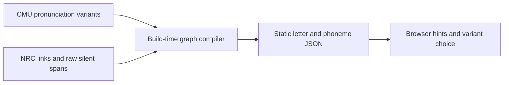

# Next path: compile an alignment graph, then derive teaching units

Proposal only; inspected the app and complete pinned NRC/CMU files on 2026-11-16. No application changes or library execution were performed for this proposal.

Use a **build-time library pipeline with a richer JSON schema**. The current compiler assumes one contiguous group per CMU phone; accepting more words safely requires changing that representation, not adding word overrides.

## What the actual data contains

| Word | Pinned NRC row | Corresponding CMU phones |
|---|---|---|
| cake | `c}k a}e\|ɪ k}k e}_` | `K EY1 K` |
| like | `l}l i}a\|ɪ k}k e}_` | `L AY1 K` |
| box | `b}b o}ɑ x}k\|s` | `B AA1 K S` |
| cute | `c}k u}j\|u t}t e}_` | `K Y UW1 T` |
| knight | `k\|n}n i}a\|ɪ g\|h}_ t}t` | `N AY1 T` |
| read | `r}ɹ e}ɛ a}_ d}d` | `R EH1 D`; CMU also has `read(2) R IY1 D` |

The full importer accepts 51,801 aligned entries after stripping CMU metadata; its rejected set includes representable silence and multiple phones, not just bad pronunciations.

## Library paths

**NRC g2p (MIT), preferred first:** the pinned API supports `make_g2p('eng', 'eng-arpabet', tokenize=False, neural=False)` for an already segmented word. The result exposes `output_string`, `alignments()`, `tiers`, and `substring_alignments()`. Use its maintained IPA conversion and index composition instead of expanding our conversion rules. Restore CMU stress only after matching the complete normalized phone sequence to a preserved CMU variant. [API][1] [graph implementation][2] [license][3]

Important limitation: indices address characters, not phoneme tokens. `substring_alignments()` explicitly warns that ARPAbet substrings need not be whole tokens. More seriously, NRC's lexicon implementation attaches an epsilon/deletion to the preceding output character where possible. Thus graph edges alone cannot recover silent letters or the pedagogical `a_e` relationship: cake's final e is attached near the final /k/. Preserve the original alignment row and its empty outputs alongside the graph. [2] [lexicon behavior][8]

**Phonetisaurus (BSD-3-Clause), second-stage candidate:** `phonetisaurus-align` aligns supplied spelling/pronunciation pairs; its C++/OpenFst implementation supports deletion links, subsequence limits, alignment models and lattices. This can create alignments for CMU variants missing from NRC without predicting a new pronunciation. Keep CMU variant IDs in a sidecar when formatting input. Build and pin the executable/model in an isolated build environment; evaluate its output before adoption. This is a statistical aligner, not a phonics curriculum. [aligner options][4] [dependencies][5] [license][6]

Neither path requires a Python, OpenFst, neural-model, or network dependency in the browser. Ship compiled JSON, optionally sharded by word prefix; browser runtime performs lookup, variant selection and rendering only.

## Data flow

## Schema and staged implementation

1. Introduce `variants[]` with immutable source IDs, exact stressed CMU `phones[]`, source spelling spans and IPA segments, plus `links: {letterIndices[], phoneIndices[]}`. Allow an empty phone array for source epsilon and multiple output phones per spelling span. Keep zero-based indices in the normalized spelling with a mapping back to displayed text. Record code/model/data revisions and notices.
2. Compile whole-pronunciation agreement through NRC's graph/token conversion; retain explicit epsilon segments separately. One diphthong `eɪ` becomes EY, whereas `ks` becomes K+S and `ju` becomes Y+UW. Match token sequences, never IPA character counts. Reject unresolved conversion/variant matches. Compare reproducible output and rejection reasons against the strict importer.
3. Render phoneme events separately from letter ownership. Both K and S events highlight x in box; Y and UW highlight u in cute. Source-empty spans receive no sound event. Unsupported instructional cues remain distinct from silence. Do not concatenate/reorder letters merely to fit a sound rail.
4. Add optional `teachingUnits: {letterIndices[], phoneIndices[], patternId, evidence}`; permit noncontiguous indices. A general, sourced pattern catalog can describe `a_e→EY`, `i_e→AY`, `u_e→Y+UW`. Match the spelling pattern **and the actual variant's phones and source-empty final e**. Then cake uses letters `[1,3]` for its EY unit, like `[1,3]` for AY, and cute `[1,3]` for Y+UW; the intervening consonant remains independent. Render a spanning connector without moving letters. This is an explicit general teaching policy, not a library-provided analysis. The existing reference chart lists these patterns and cue as long u. [7]
5. Keep every distinct CMU pronunciation, including variant suffixes. NRC supplies only one read pronunciation; it does not identify tense or intended meaning. For multiple pronunciations, require explicit selection or withhold pronunciation-dependent annotation. Align each selected missing variant with Phonetisaurus if adopted. Never pick the first variant or infer semantics from suffix `(2)`.
6. Gate rollout with fixtures for cake/like, box, cute/music, knight, love (must not acquire an a_e-style long-vowel rule), and both read variants. Assert spelling conservation, complete ordered phone coverage, preserved source-empty spans, repeated-letter highlighting and no guessed variant. Review a stratified sample before replacing strict import; report source agreement separately from teaching quality.

## Limits

This removes the need for word-by-word pronunciation patches, not the need for a declared teaching policy. Neither library supplies validated split-digraph teaching units, cue duration, or contextual heteronym certainty. Statistical letter links can be pedagogically odd: pinned apple assigns /ʌ/ to its second p. Pronunciation agreement alone must not certify such links as teaching units. Leave unsupported units plain; do not grow a hidden exception list.

[1]: https://github.com/NRC-ILT/g2p/blob/ada77007168481de7422c6a44d6bc3df1ad95f4e/g2p/__init__.py#L32-L59
[2]: https://github.com/NRC-ILT/g2p/blob/ada77007168481de7422c6a44d6bc3df1ad95f4e/g2p/transducer/__init__.py#L198-L254
[3]: https://github.com/NRC-ILT/g2p/blob/ada77007168481de7422c6a44d6bc3df1ad95f4e/LICENSE
[4]: https://github.com/AdolfVonKleist/Phonetisaurus/blob/master/src/bin/phonetisaurus-align.cc#L215-L240
[5]: https://github.com/AdolfVonKleist/Phonetisaurus/blob/master/README.md
[6]: https://github.com/AdolfVonKleist/Phonetisaurus/blob/master/LICENSE
[7]: https://www.hookedonphonics.com/wp-content/uploads/2025/05/44-phonemes-chart-rev2.pdf
[8]: https://github.com/NRC-ILT/g2p/blob/ada77007168481de7422c6a44d6bc3df1ad95f4e/g2p/transducer/__init__.py#L765-L806
