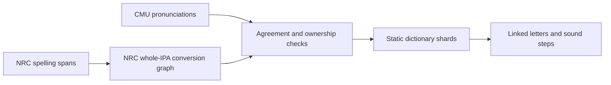

# Alignments: implemented path and next work

The reader now uses the pinned [NRC g2p library](https://github.com/NRC-ILT/g2p/tree/ada77007168481de7422c6a44d6bc3df1ad95f4e) at build time. The browser performs lookup and rendering, not pronunciation prediction.

## Implemented

- Convert complete IPA sequences through NRC, including sounds that cross source-segment boundaries. Keep raw source-empty spans separately; the library's deletion edges cannot recover pedagogical silence by themselves.
- Preserve letters and phoneme events separately. Silent spans add no sound step; x can link to both /k/ and /s/. Multiple spelling spans can link to one sound.
- Apply general, sourced spelling patterns for teams and split vowels. These teaching units are separate from the raw dictionary links; there are no word-specific grouping overrides.
- Preserve CMU variant IDs. The parent can choose a pronunciation; an alternative without an accepted alignment receives no guessed letter hints. Device speech may use another variant.
- Withhold unresolved or questionable ownership, such as a vowel placed on a consonant letter without a supported teaching unit. Source agreement is not proof of good instruction.

Normal builds use vendored graph data and remain offline. The optional Python refresh script pins the NRC revision and public dependency artifacts; see `scripts/preprocess-alignments.py`.

## Remaining work

1. Review the [500-word audit](../evaluation/common-words.md), prioritizing common words still withheld. Compare actual source spans before changing any teaching pattern.
2. Evaluate [Phonetisaurus](https://github.com/AdolfVonKleist/Phonetisaurus) for aligning existing CMU pronunciation variants missing from NRC. It is a BSD-licensed statistical aligner, not a source of teaching semantics; no model or executable is bundled yet.
3. Compare independent alignments for questionable spans and review teaching suitability before admission. Keep unresolved cases explicit rather than growing a word exception list.
4. Test graph highlighting with parents and children, including split vowels, repeated letters, syllabic consonants and variant choices.

The [gradual-reading scope](gradual-reading.md) describes the separate audio/timing work needed for spoken step-by-step reading.
