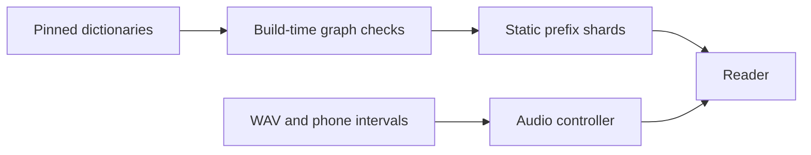

# Development

Static TypeScript + Vite; Node is pinned with Hermit.

```sh
bin/npm ci
bin/npm run dev
bin/npm test
bin/npm run build
```

Vite prints the local address. Pushes to `main` validate and deploy GitHub Pages.



`data:build` regenerates dictionary and review assets; `data:check` verifies them. `evaluate:sentences` and `evaluate:common` reproduce the test reports (`-- --check` verifies saved results).

Optional refresh tools use uv: `data:preprocess` rebuilds NRC graphs; `audio:prepare` rebuilds the four recording previews (also needs ffmpeg). Normal builds are offline and need only Node.
