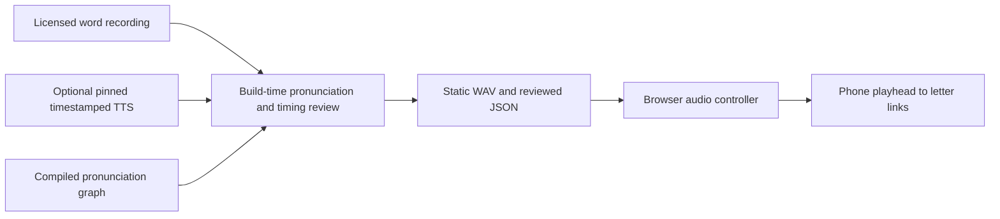

# Gradual word reading: first audio slice

Status: proposed 2026-11-16; source/app inspection only. No audio downloaded, aligned, listened to, or shipped.

**Next experiment:** curate Dad, She, hello and sheep from the same Dvortygirl US-English recordings, manually review their phone timings, then implement tap-and-follow over those four static assets. This is the smallest evidenced path to hearing a word while its letters light up. Test holding sounds separately before promising continuous drag-to-blend. The 500-word text corpus does not imply audio coverage.

## Architecture and data contract

One audio asset matches one immutable pronunciation variant, not just a spelling. Ship `word`, `variantId`, exact ordered `phones`, `audioUrl`, processed `sha256`, `sampleRate`, `frameCount`, and `review` metadata. Each phone event has `phoneIndex`, integer `startFrame`/`endFrame`, and optional separately reviewed `sustainStartFrame`/`sustainEndFrame`. Frames reference the processed WAV sample rate; convert to seconds before buffer offsets because browser decoding may resample. Bind timings to that exact asset; record original and processed hashes, source page/revision, author, license, retrieval date and edits in its provenance manifest.

Join events to the richer graph's phone indices; derive highlighted letter indices through graph links. Keep audio metadata separate from the dictionary so text-only vocabulary remains cheap. Validate variant/phone equality, frame bounds and ordering, graph coverage, provenance, and explicit review approval at build time. Preserve closure/silence where appropriate; do not force every frame into an artificial isolated phone.

Two events may highlight the same letter: x in box is K then S, and u in cute is Y then UW. One phone may highlight several letters, including a supported split digraph. Silent letters have no invented audio event. A repeated word in the sentence uses the same asset but a distinct occurrence/playback session. No spelling-width-to-millisecond calculation.

## First useful behavior: tap and follow

1. Select a reviewed word. Fetch/decode its small asset and show loading/ready/error status; selecting a word alone stays silent.
2. Tap **Hear word** to play its natural recording from the beginning. Drive visual phone progress from the audio clock, with animation frames only rendering that position. Keep the full word visible; highlighting follows the spoken phone through its letter links.
3. Tap a sound step to start at that reviewed phone onset and continue through the rest of the word, preserving context. Describe this as “Hear from this sound”; a waveform crop is not necessarily a clean isolated teaching sound. Stop/closure onset needs listening review.
4. A new action stops the prior session immediately; only one voice plays. Repeated taps replace playback, with no stale queue. **Stop** and Escape stop audio and clear the active marker.
5. Unsupported or unreviewed variants keep the existing silent guide and separate system **Hear word**. Never animate guessed timings over browser `speechSynthesis`.

Integration seams inspected in `src/main.ts`: `selectWord`, `activate`, `renderText`, `stopSpeech`, the Hear word handler, rail pointer events and range `input`. Introduce one `AudioController` owning `prepare`, `playWord`, `playFromPhone`, `stop` and a session generation. Make its active phone update presentation without calling `activate` recursively. Consolidate system speech cancellation and buffer cancellation behind the same stop path; reviewed recording playback must not depend on an installed system TTS voice. Replace the current `SoundGroup[]`/one-group-per-phone assumption with the graph's selected variant before joining timings; `src/lexicon.ts` already provides lazy static-asset loading and normalization patterns.

## Second experiment: drag and hold

Enable only for assets with reviewed transitions and sustain regions. Map the existing measured rail/handle to ordered phone events; letter widths determine hit targets, never sound duration. Start with a bounded proof on She/sheep and Dad for the stop contrast.

- Pointer down enters a sound; forward movement requests the next sound/transition. A continuant may play its reviewed steady region while the finger dwells, then play its recorded exit on advance. Begin with short, explicitly bounded holds; evaluate seams before selecting loop or overlap/crossfade machinery.
- Stops such as D/P play closure and release once per entry, then wait silently when held. Never loop a burst, repeatedly retrigger while stationary, or add “duh/puh.” A `stretch` cue alone grants no sustain region. Diphthongs need their own policy; do not freeze an arbitrary midpoint.
- Backward movement or a large jump stops the current voice and repositions; it does not play reversed speech or queue every crossed phone. Re-entry may trigger a stop again. Pointer release/cancel/lost capture stops; no automatic completion after the finger leaves.
- Preserve normal-pitch natural word playback as the comparison. `AudioBufferSourceNode.playbackRate` changes pitch; neither it nor changing TTS rate establishes clean stretching. No AudioWorklet, granular/time-stretch package or runtime model is selected for this first slice.
- Keep a native keyboard range: arrows choose a phone silently, Enter/Space explicitly audition from it, Home/End choose endpoints, Escape stops. A separate hold button can later offer keydown/keyup sustain; avoid automatic speech on every screen-reader range announcement.

## Browser and cancellation prerequisites

Use a single lazily created `AudioContext`; create/resume it directly in an intentional click/pointer/keyboard handler. Preload/decode separately. If loading outlives that gesture and the context remains suspended, show **Ready—tap to hear** and require another gesture; do not assume async completion carries audio permission. Check `resume()` rejection/context state and offer retry. iPhone/iPad Safari behavior must be verified on hardware, including headphones, screen lock and return from background.

For each play, create a fresh one-shot buffer source and gate completion/highlight callbacks with a generation ID. Cancel on word/variant change, text edit, Stop/Escape, pointer cancellation, lost capture, `visibilitychange` to hidden, and `pagehide`. Abort/ignore stale preparation after selection changes. Stop sources, disconnect nodes and use a short gain ramp where safe; do not leave loops alive. Limit touch-action suppression to the interactive rail so normal page scrolling still works elsewhere.

## Sources, rights and current limits

| Candidate | Exact prerequisite / limit |
|---|---|
| Recommended four-word pilot | [Dad](https://commons.wikimedia.org/wiki/File:En-us-dad.ogg), [She](https://commons.wikimedia.org/wiki/File:En-us-she.ogg), [hello](https://commons.wikimedia.org/wiki/File:En-us-hello.ogg), [sheep](https://commons.wikimedia.org/wiki/File:En-us-sheep.ogg): surveyed as Dvortygirl US English. Dad/She/sheep offer [CC BY-SA 3.0](https://creativecommons.org/licenses/by-sa/3.0/); hello has a public-domain release. Recheck/pin file-page revisions before import, retain attribution/license and mark changes; distribute adapted share-alike audio under the required compatible terms. No timestamps or safe loops supplied. |
| HeadTTS comparison, after pilot | [HeadTTS](https://github.com/met4citizen/HeadTTS) documents PCM/WAV plus phone timestamps and MIT code; its [timestamped Kokoro model](https://huggingface.co/onnx-community/Kokoro-82M-v1.0-ONNX-timestamped) is identified as Apache-2.0. Pin code/model/voice and review their actual notices and output-use terms before generation. Audit timestamp derivation and pronunciation against listening. Standard Kokoro model sizes do not establish timestamped artifact size. Desktop Safari documentation does not validate iOS. Generate/review/export at build time; never place inference on the drag path. |
| Alignment tools | Four words can be marked manually in Praat; MFA is optional comparison, not a prerequisite or ground truth. If used, pin software and [US ARPA model](https://mfa-models.readthedocs.io/en/latest/acoustic/English/English%20%28US%29%20ARPA%20acoustic%20model%20v3_0_0.html) (CC BY 4.0), retain model notices, review boundaries against the actual recording. |

The prior source surveys established metadata/documentation only. They did not establish suitable vowels/stress (especially hello), Dad's final release, boundary accuracy, loop quality, phonics teaching suitability, mobile latency, or cached/offline behavior. Phone boundaries in coarticulated speech can be ambiguous. Manual review is required before describing any asset as ready. Runtime needs only static files and browser playback; this scope adds no API key, backend, model download or generated-audio service.

## Phased acceptance checks

- **A — asset pilot:** source revisions/notices/hashes retained; parent listens to all four words; exact pronunciation variant chosen; reviewed frame intervals join every phone to the intended letters; unsupported variants remain unavailable. Export reproducibly. Do not pad the set to 500.
- **B — tap-and-follow:** real iPhone/iPad Safari and desktop pass cold load, retry, first-gesture start, normal playback, sound-onset playback and linked-letter highlights. Rapid retaps/selection changes never overlap or revive stale sound. Keyboard and screen-reader labels work. Escape/background/edit stop promptly; unreviewed words retain honest fallback.
- **C — bounded drag trial:** parent recognizes the intended sounds at slow/fast motion; She/sheep holds have no objectionable clicks, pitch jump or added vowel; Dad/sheep stops release once. Reversal, jumps, cancel/lost capture and key release leave no sound running. Record device/version and listening result. If the recordings cannot sustain cleanly, keep B useful and compare purpose-recorded slowed speech with build-time HeadTTS; do not hide the failure with a large DSP dependency.
